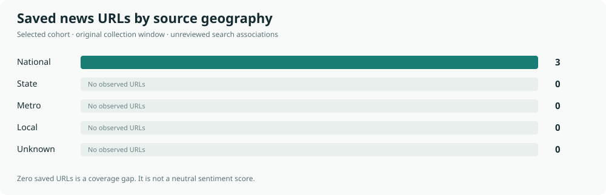
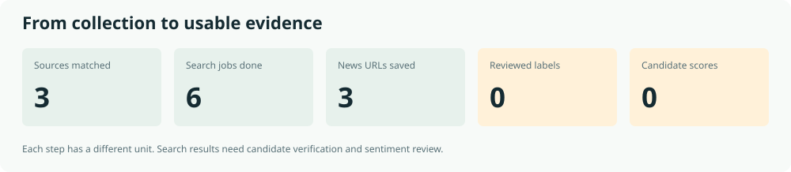

# Midterm / Media Observatory

**24 congressional registrations · 3 saved news URLs · 0 reviewed labels**

Original window: **2026-09-01 through 2026-10-06**. Retrospective research; coverage is partial.

[Open analysis run](https://github.com/meteor21/Simulations/actions/runs/38097810150) · [Download interactive dashboard](https://raw.githubusercontent.com/meteor21/Simulations/analysis-dashboard/index.html) · [Candidate CSV](candidate_coverage.csv) · [Public metadata](data.json)

The HTML dashboard is self-contained: save `index.html` and open it in a browser to search candidates, filter coverage and inspect sources.

## Coverage and review

Source geography for **3 saved URLs** uses profiles whose historical applicability is unverified. Geographic scope describes the outlet; it does not establish candidate-state relevance or district readership.

**0 of 24 candidates have usable reviewed sentiment scores.** Missing values remain unavailable; they are never filled with neutral values.

## Collection allowance

**16/20 requests used; 4 remaining.** This analysis made zero provider requests. Earlier attempts remain charged.

## Candidate evidence

URL counts below are **unreviewed search associations**, not verified candidate mentions. FEC registrations are not certified ballot contestants.

| Candidate | Race | Party | Search-linked URLs | Reviewed labels | Sentiment |
|---|---|---|---:|---:|---|
| Jim C Mcdermott \(H2AK00143\) | AK House 00 | LIB | 1 | 0 | Awaiting review |
| David Ambrose \(H2AK00556\) | AK House 00 | N | 1 | 0 | Awaiting review |
| Nicholas Iii Begich \(H2AK01083\) | AK House 00 | REP | 1 | 0 | Awaiting review |
| Hampton Harris \(H4AL02139\) | AL House 02 | REP | 1 | 0 | Awaiting review |
| Bobby Wilson \(H4AR03081\) | AR House 03 | LIB | 1 | 0 | Awaiting review |
| John Brendan Williams \(H6AK01068\) | AK House 00 | DEM | 1 | 0 | Awaiting review |
| Bill Hill \(H6AK01092\) | AK House 00 | IND | 1 | 0 | Awaiting review |
| Melanie A. Salazar \(H6AK01118\) | AK House 00 | NON | 1 | 0 | Awaiting review |
| David Ii Ambrose \(H6AK01134\) | AK House 00 | UN | 0 | 0 | Awaiting review |
| Lee Jeh Cobb \(H6AL04171\) | AL House 04 | W | 0 | 0 | Awaiting review |
| Crystal I Mrs Ball \(H6AL05277\) | AL House 05 | NNE | 0 | 0 | Awaiting review |
| Keith Ross Pilkington \(H6AL06143\) | AL House 06 | DEM | 0 | 0 | Awaiting review |
| William Karl Mr. Iv Puetz \(H6AL06176\) | AL House 06 | IND | 0 | 0 | Awaiting review |
| Chase Mcdowell \(H6AR02278\) | AR House 02 | REP | 0 | 0 | Awaiting review |
| Zackary Blake Huffman \(H6AR02294\) | AR House 02 | DEM | 0 | 0 | Awaiting review |
| Christopher John Mr. Ii Hocevar \(H6AR03144\) | AR House 03 | IND | 0 | 0 | Awaiting review |
| Dustin Thomas House Darden \(S6AK00268\) | AK Senate | REP | 2 | 0 | Awaiting review |
| Carol Hafner \(S6AK00284\) | AK Senate | DEM | 2 | 0 | Awaiting review |
| Heather G Mcelwain \(S6AK00292\) | AK Senate | LP | 2 | 0 | Awaiting review |
| Reece Roberts \(S6AK00318\) | AK Senate | NON | 2 | 0 | Awaiting review |
| Kyle Sweetser \(S6AL00435\) | AL Senate | DEM | 2 | 0 | Awaiting review |
| Gavin Solomon \(S6AL00534\) | AL Senate | REP | 2 | 0 | Awaiting review |
| Hallie Shoffner \(S6AR00199\) | AR Senate | DEM | 2 | 0 | Awaiting review |
| Scott A. Kohlhaas \(S8AK00066\) | AK Senate | LIB | 2 | 0 | Awaiting review |

## Source lookups

| Source | Geography | Result |
|---|---|---|
| alabamareflector.com | state / AL | not\_found |
| alaskabeacon.com | state / AK | not\_found |
| apnews.com | national | exact\_root\_homepage\_match |
| arkansasadvocate.com | state / AR | not\_found |
| cnn.com | national | exact\_root\_homepage\_match |
| foxnews.com | national | exact\_root\_homepage\_match |

Directory absence does not establish that an outlet published no campaign news. Dated source geography provenance is retained in the interactive dashboard and public JSON.

## Interpretation

Media portrayal is not representative public opinion. Survey favorability remains separate. Source partisanship has no automatic weight penalty. This small retrospective pilot does not establish sentiment accuracy or forecasting value.

Only selected-cohort public metadata is published here. Article bodies, titles, private review evidence, credentials and the database are excluded. Any available sentiment feature has its own documented lookback window in the public JSON; this is separate from the collection-window metadata counts.

[Original collection](https://github.com/meteor21/Simulations/actions/runs/37680664034) · [Analysis source](https://github.com/meteor21/Simulations/tree/b8ace01b1787850a6ff3eb898075457aa8330f20) · [Colab notebook](https://colab.research.google.com/github/meteor21/Simulations/blob/main/notebooks/Midterm_Sentiment_Agents_Colab.ipynb)
